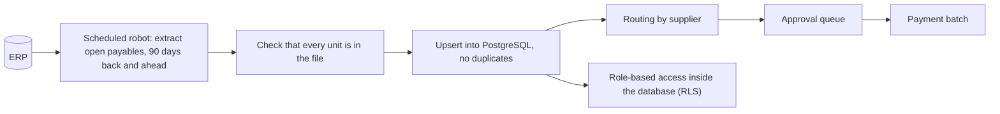

# Accounts payable: from extraction to approval and payment batch

> **Finance** · In production
>
> Parte do meu portfólio / Part of my portfolio: [portfolio-automacoes](https://github.com/Rapunzelmina/portfolio-automacoes) · [Português](#português) · [English](#english)

## Como funciona / How it works

## Português

### Contas a pagar: da extração à aprovação e ao borderô

**Área:** Financeiro · **Status:** Em produção

#### Problema

O contas a pagar vivia dentro do ERP, sem uma fila clara de aprovação nem uma visão consolidada do que pagar e quando.

#### Solução

Um robô agendado extrai as contas a pagar (janela de 90 dias para trás e para frente) e grava num banco PostgreSQL, sem duplicar registros. Depois de exportar, ele confere se todas as unidades esperadas vieram no arquivo, porque um arquivo parcial já chegou a subir ao banco sem ninguém perceber. Sobre esses dados foram construídos a fila de aprovação, regras de roteamento por fornecedor, categorias automáticas para fornecedores novos e o borderô de pagamentos, tudo com controle de acesso por perfil no próprio banco (row level security).

#### Tecnologias

- Python
- Playwright
- PostgreSQL / Supabase (REST, triggers, RLS)
- SQL
- Windows Task Scheduler

#### Resultado

O que antes era uma lista dentro do ERP virou um fluxo com aprovador, histórico e borderô, atualizado todo dia sem intervenção.

#### O que eu fiz

Entendi como o pagamento era aprovado na prática e transformei esse fluxo em tabelas, regras de roteamento e permissões por perfil dentro do banco de dados, pesquisando como aplicar segurança por linha (RLS) e triggers. Ao descobrir que o arquivo exportado podia chegar incompleto, acrescentei a validação de cobertura antes do envio.

## English

### Accounts payable: from extraction to approval and payment batch

**Area:** Finance · **Status:** In production

#### Problem

Accounts payable lived inside the ERP, with no clear approval queue and no consolidated view of what to pay and when.

#### Solution

A scheduled bot extracts accounts payable (a 90-days-back, 90-days-ahead window) and writes them to a PostgreSQL database without duplicating records. After exporting, it checks that every expected unit is in the file, because a partial file once reached the database unnoticed. On top of that data I built the approval queue, supplier-based routing rules, automatic categories for new suppliers and the payment batch, all with role-based access enforced in the database itself (row level security).

#### Tech

- Python
- Playwright
- PostgreSQL / Supabase (REST, triggers, RLS)
- SQL
- Windows Task Scheduler

#### Result

What used to be a list inside the ERP became a workflow with approver, history and payment batch, refreshed every day with no intervention.

#### What I did

I worked out how payments were actually approved and turned that flow into tables, routing rules and per-role permissions inside the database, researching how to apply row-level security (RLS) and triggers. When I found that the exported file could arrive incomplete, I added a coverage check before upload.

---

*Código-fonte privado: contém integrações e informações do ambiente corporativo. Este repositório apresenta o projeto como um *case* técnico de portfólio e não contém código, credenciais, dados de clientes, nomes de lojas ou fornecedores, nem URLs ou números internos.*

*Source code is private: it contains integrations and information from the corporate environment. This repository presents the project as a technical portfolio case study and contains no code, credentials, customer data, store or supplier names, or internal URLs or figures.*
